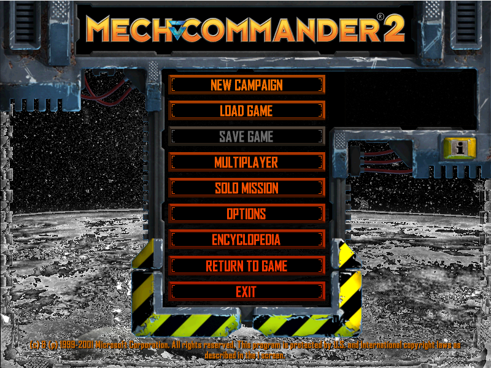

# MechCommander 2 — Static Recompilation

Static recompilation of **MechCommander 2** (FASA Interactive / Microsoft,
2001), from its shipping Win32 executable to native C that builds on Windows
10 and 11.

Built on the [pcrecomp](https://github.com/sp00nznet/pcrecomp) toolchain and
following its shared house style (layout, CLI, conformance harness). Generated
source is **not** distributed: you bring your own disc and the pipeline
rebuilds everything locally.

## Status: **v0.1.0-dev, early bring-up. Boots through the intro movie to the main menu, hardware-rendered, in a window.**

| Stage | State |
|---|---|
| Identify the binary | `Mc2Rel.exe` (VC6, GameOS over DirectX 7). SafeDisc 2 sections present but `.text` is plain ([docs/architecture.md](docs/architecture.md)) |
| Game files | copied from your disc, ISO, MDF or a .zip holding one by `tools/gamefiles.py`; the disc runs as is, no installer |
| Symbols | the disc ships `MC2REL.PDB`, matching the exe: 9,776 named functions, 5,525 with sizes (pcrecomp `pdb2_ref.py`, pcrecomp#162) |
| Function catalog | disasm32 seeded from the PDB: 15,002 functions, recall 99.99% against the PDB (unseeded: 89.7% precision, 85.4% recall) |
| Lift (`run_lift.py`) | **whole program**: 15,007 functions, 0 lift errors, 156 with no terminator, 5.46M lines of C |
| Host (`build/mc2.exe`, 32-bit, pcrecomp `native32`) | builds (netlab clang-cl). Maps Mc2Rel.exe and binds all 356 imports, 0 unresolved |
| Running the game | `--run` plays the Microsoft logo movie and reaches the **main menu** (Direct3D 7 on the GPU, windowed). Not yet tried: getting into a mission |

## Screenshots



## What is not in this repo

The game, its debug symbols, and anything made from them. `game/` (your
disc's files), `work/` (the catalog and lift statistics) and
`src/recomp/gen/` (the lifted C) are built on your machine and gitignored.
Microsoft's 2006 MechCommander 2 source release is not used here, and must
not be read while working on this repo: see [NOTICE](NOTICE).

## Getting Started

You need your **MechCommander 2 CD** (in a drive, as an `.iso`/`.mdf`, or a
`.zip` holding the image), Windows 10 or 11, and about 4 GB free.

### Quick start

1. Download this repository and [pcrecomp](https://github.com/sp00nznet/pcrecomp)
   side by side, with pcrecomp in a folder named `tools`:
   ```
   somewhere\mechcommander2-recomp   somewhere	ools\              <- pcrecomp
   ```
   (If `tools` is missing, Setup offers to fetch it with git.)
2. Double-click **`Setup.cmd`**. It checks for Python, the Python packages,
   Visual Studio, CMake and Ninja, and asks before installing anything
   missing. It then finds your disc, or asks for its path, copies it into
   `game\`, catalogs, lifts and builds. Expect 30 to 60 minutes the first
   time. A rerun skips what is done.
3. When it says **Done**, `MechCommander 2 (recomp).cmd` is in the folder.
   Expect early bring-up: see Status.

If it stops, it says why in one line, and the full log is `setup.log`.

### Step by step

Prerequisites: **Python 3.10+** with `pefile` and `capstone`, **Visual Studio
2022** (or its Build Tools) with *Desktop development with C++*, **CMake
3.20+** and **Ninja**. These are exactly the commands Setup runs.

```bat
:: 0. the toolkit, beside this repo
git clone https://github.com/sp00nznet/pcrecomp ..\tools
py -3 -m pip install --user pefile capstone

:: 1. your disc -> game\   (a drive, a folder, an .iso/.mdf, or a .zip holding one)
py -3 tools\gamefiles.py D:\path\to\mech-commander-2.zip
::   taking MechCommander2.iso out of ...
::   reading ... files (... MB) from ...
::   done: ...\game

:: 2. the function catalog -> work\pdb_ref.json, work\functions.json
py -3 tools\catalog.py
::   [*] game\MC2REL.PDB: 9776 functions (5525 with ranges) -> work\pdb_ref.json
::   [*] Successfully disassembled 13447 functions (5 discovery rounds)

:: 3. the lift -> src\recomp\gen\
py -3 run_lift.py
::   lifted 15007   errors 0   no terminator 156
::   5,458,275 lines of C in 38 files

:: 4. the host -> build\mc2.exe
build.cmd

:: 5. map and bind Mc2Rel.exe (no window)
build\mc2.exe
```

The usual trip-ups:

- **`python` opens the Microsoft Store.** That is the Store's placeholder.
  Use `py -3`, or turn off the alias under *Settings > Apps > Advanced app
  settings > App execution aliases*.
- **A tool installed but "not found".** PATH changes reach new windows only:
  open a new terminal.
- **pcrecomp somewhere else.** Set `PCRECOMP` to its folder before steps 1-3,
  and run `set CMAKE_ARGS=-DPCRECOMP=<folder>` before step 4.
- **`build.cmd` uses the 64-bit-hosted x86 compiler** (`amd64_x86`): the
  32-bit `cl.exe` runs out of heap on a 400-function chunk.

## Usage

```
build\mc2.exe                       map Mc2Rel.exe and bind its imports, then stop
build\mc2.exe --run                 run the game (opens its window)
build\mc2.exe --run --watchdog 30   ...and stop after 30 s with a report of where it is
build\mc2.exe --game D:\mc2         use an install somewhere other than game\
build\mc2.exe --native-trace        one line per call into Windows or DirectX
build\mc2.exe --callbacks           one line per call from Windows back into the game
py -3 tools\conformance.py [--run]  the conformance harness
```

A fault prints the lifted function it happened in, the last native call, the
registers and the last indirect calls.

`--headless --record out.mp4`, the house style's headless mode, is not in
yet ([ROADMAP.md](ROADMAP.md)).

## Building from source

Steps 2 to 4 above are the whole build. On a machine with
[recomp-netlab](https://github.com/sp00nznet/recomp-netlab), `netlab build
mechcommander2-recomp` compiles on the farm instead (recipe
`projects/mechcommander2-recomp.env`). The lifted C goes over, and the game does
not.

[docs/architecture.md](docs/architecture.md) explains how the parts fit.

## License

MIT for what is ours (the host, the tools, the docs): [LICENSE](LICENSE).
MechCommander 2 itself is not covered, and lifted code carries the original's
licence, not this one: [NOTICE](NOTICE).
